<picture>
  <source media="(prefers-color-scheme: dark)" srcset="assets/header-dark.svg">
  
</picture>

  

    

  # Manan Khanna

  

    
  

  ### 🚀 Shipping AI Apps & Full-Stack Products

  **BE CSE (Full Stack Development) • Full-Stack Developer • AI Enthusiast**

   

  
  
  

---

### 👨‍💻 About Me

I'm a **BE CSE (Full Stack Development), Semester 3** student at **Chandigarh University, Apex Institute of Technology** who prefers shipping products over just writing code.

- 📱 **Currently:** Shipping the AI full-stack trio — **StudySage**, **ResumeLens** and **SpendWise** — and building **PaperTrail** next, due 24 Nov 2026.
- 🧠 **AI Focus:** On-device, rule-based AI in real apps — study copilot, resume analyser, expense insights — plus a voice-first assistant, JARVIS-NOVA.
- 🏆 **Research:** Co-author on **MalwareVision** (IEEE, CNN + behavioural malware detection, v6 — 13 pp, 30 refs) and **evidence-chain**, an SIH 2026 Phase 1 evidence-integrity prototype.
- 🤝 **Collaboration:** Open to collaborating on AI, React / full-stack, and ambitious student-built products.

---

### 📡 Technical Capability & Skills Radar

  

### 🛠️ Core Tooling & Technologies

| **Category** | **Technologies** |
| --- | --- |
| **Web Development** |  |
| **AI & Python** |  |
| **Backend & Data** |  |
| **Tools & Platforms** |  |

---

### 📈 Activity & Contribution Flow

  
   
  
   
  
   
  

---

### ⚡ Engineering Showcase & Performance

  

| Project | What it does | Stack |
| --- | --- | --- |
| [**Does-It-Fly-Dare-Edition-App**](https://github.com/Manan-Khanna05/Does-It-Fly-Dare-Edition-App) | Multiplayer dare game — spin, dare, fly. Real-time rooms over socket.io, mobile-ready with Capacitor. | React 19, TypeScript, Capacitor, socket.io |
| **evidence-chain** | Court-facing evidence-integrity console for the RPF → GRP custody seam, with ESP32-S3 gateway. SIH 2026 Phase 1. | TypeScript, React, ESP32-S3 |
| **Lyrics-Sync-Powered-by-AI** | Automatic lyrics synchronisation with ML, speech recognition & beat detection. Karaoke mode, LRC/SRT export. | JavaScript, React, ML |
| **JARVIS-NOVA** | Voice-first AI copilot for hands-free system control. BYO STT / LLM / TTS. | Python |
| **ai-image-generator** | Text-to-image generator — natural-language prompts to visuals. | JavaScript |
| [**StudySage AI**](https://github.com/Manan-Khanna05/studysage-ai) | Notes → summary, flashcards & quiz + Pomodoro. | React, TypeScript, Node, Express |
| [**ResumeLens AI**](https://github.com/Manan-Khanna05/resumelens-ai) | Resume + job description → ATS score (sample 70/100). | React, TypeScript, Node, Express |
| [**SpendWise AI**](https://github.com/Manan-Khanna05/spendwise-ai) | ₹ expense tracker with smart insights & month-end forecast. | React, TypeScript, Node, Express |

### 🔜 Next Up

**PaperTrail** — previous-year question-paper analyser: mines repeated questions & topics across years, predicts high-probability topics per subject. Due **24 Nov 2026** — a new researched AI project lands every 10 days.

### 🎮 The Human Side

I'm not just a code machine. When the IDE closes, here is who I am:

- **🤖 Current Obsession:** Building a voice-controlled AI desktop assistant (JARVIS-NOVA) that actually does things — open apps, run scripts, manage files.
- **🔔 Tinkering:** A new researched AI project every 10 days — next up is PaperTrail, a previous-year question-paper analyser.
- **📄 Philosophy:** Ship real, working products with verified numbers — no fake stats, no invented results.

---

  Let's build something incredible together.
   
  Profile style inspired by <a href="https://github.com/anasjameel300/anasjameel300">anasjameel300's profile generator</a> — rebuilt with my own code. Dot-matrix portrait generated from my own photo; the source photo is not published here.

